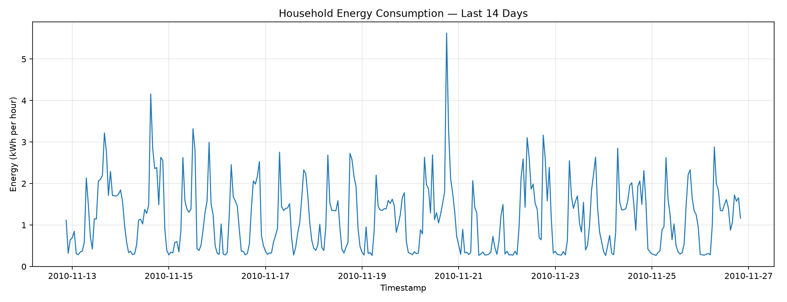
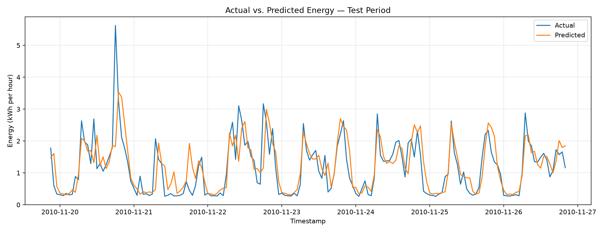
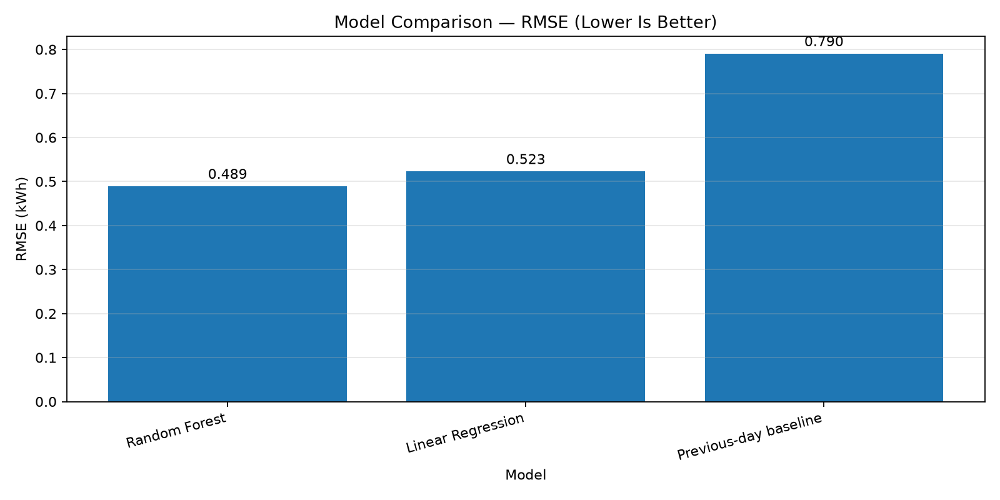
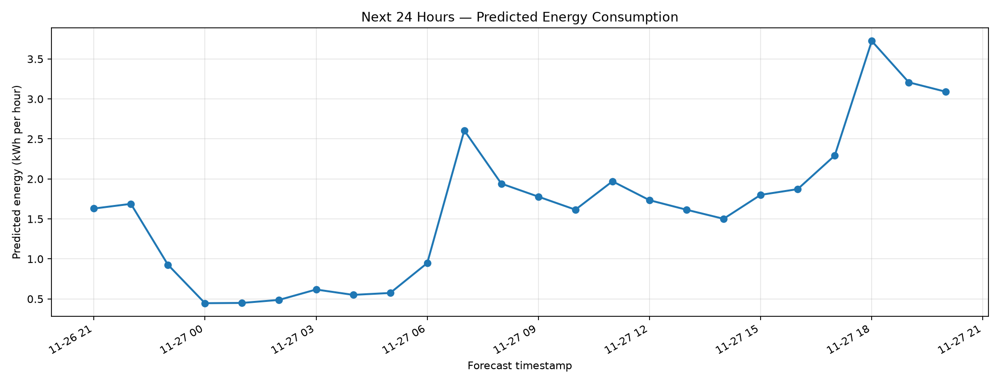

# AI-Powered Energy Consumption Forecasting System

An end-to-end machine learning project that analyzes historical
electricity consumption, compares forecasting models, predicts energy
consumption for the next 24 hours, and estimates illustrative
electricity costs.

## Project Overview

Energy consumption forecasting can help households and energy managers
understand consumption patterns and plan energy usage.

This project uses a public household electricity dataset to build a
forecasting pipeline with data preprocessing, feature engineering,
machine learning, model evaluation, visualization, and a simulated cost
report.

-   **Project type:** Machine Learning / Time-Series Forecasting
-   **Language:** Python
-   **Status:** Core forecasting pipeline implemented

> **Important:** This is an educational forecasting project using
> historical household data. It is not connected to live smart meters,
> industrial equipment, or real-time electricity systems.

## Key Features

-   Processes more than two million original electricity readings.
-   Aggregates minute-level active power readings into hourly energy
    estimates.
-   Creates time-based and historical-consumption features.
-   Trains and compares Linear Regression and Random Forest models.
-   Compares machine learning performance against a previous-day
    baseline.
-   Generates a rolling 24-hour energy forecast.
-   Produces four visualization charts.
-   Exports model evaluation results, predictions, and forecast data to
    CSV.
-   Estimates illustrative electricity costs using an assumed tariff of
    ₹8 per kWh.
-   Provides a command-line interface to execute individual stages or
    the complete pipeline.

## Dataset

**Source:** UCI Machine Learning Repository --- Individual Household
Electric Power Consumption

Dataset page:
https://archive.ics.uci.edu/dataset/235/individual+household+electric+power+consumption

The dataset contains approximately 2.07 million minute-level
observations from a household in France, collected between December 2006
and November 2010.

This project uses the `Global_active_power` measurement to estimate
hourly energy consumption.

### Data Preparation

  Item                                             Result
  ------------------------------------------- -----------
  Original observations                         2,075,259
  Valid hourly records                             34,173
  Usable feature records                           34,005
  Engineered features                                   8
  Missing values in final processed dataset             0

Hourly energy is estimated by averaging valid power readings within each
hour. Since average power in kW over a one-hour interval corresponds
numerically to energy in kWh, the hourly mean power is used as the
hourly energy estimate.

The preparation process handles missing readings and interpolates
eligible short gaps. The dataset can still contain gaps between valid
timestamps, so missing-hour handling should be considered when
interpreting time-based features and evaluation results.

## Technology Stack

-   **Python 3.11** --- application language
-   **Pandas** --- data processing
-   **NumPy** --- numerical operations
-   **Scikit-learn** --- machine learning and evaluation
-   **Matplotlib** --- visualization
-   **Joblib** --- model persistence

## Machine Learning Approach

### Engineered Features

The forecasting model uses eight features:

1.  Hour of day
2.  Day of week
3.  Day of year
4.  Weekend indicator
5.  Previous-hour consumption (`lag_1`)
6.  Previous-day consumption (`lag_24`)
7.  Previous-week consumption (`lag_168`)
8.  Rolling mean of the previous 24 hours

### Models Evaluated

-   Previous-day baseline
-   Linear Regression
-   Random Forest Regressor

The data is split chronologically into training and testing periods
rather than randomly shuffled.

## Model Results

The initial chronological holdout evaluation produced the following
results:

  Model                     MAE (kWh)   RMSE (kWh)        R²
  ----------------------- ----------- ------------ ---------
  Random Forest                0.3370       0.4891    0.5667
  Linear Regression            0.3729       0.5227    0.5051
  Previous-day baseline        0.5356       0.7903   -0.1315

Random Forest achieved the lowest RMSE among these evaluated models and
was selected for forecasting.

**Metric interpretation:**

-   **MAE:** Average absolute difference between actual and predicted
    hourly energy.
-   **RMSE:** Penalizes larger prediction errors more heavily.
-   **R²:** Measures how much variation in the target is explained
    relative to a mean-prediction reference.

These are preliminary project results, not a guarantee of future
performance. The evaluation and model-selection procedure should be
strengthened before making production-performance claims. In particular,
use a separate validation period for model selection and preserve an
untouched final test period for a more robust assessment.

## Forecast Example

The implemented forecasting module generated these summary results:

  Forecast metric                     Result
  ------------------------------ -----------
  Forecast horizon                  24 hours
  Total predicted energy           39.07 kWh
  Average hourly energy             1.63 kWh
  Peak predicted hourly energy      3.72 kWh

Forecast timestamps follow the end of the historical dataset. The
example therefore represents a forecast beginning in November 2010, not
a current forecast.

## Illustrative Cost Simulation

The project estimates costs using an assumed flat electricity tariff of
₹8/kWh.

-   **Predicted 24-hour energy:** approximately 39.07 kWh
-   **Estimated 24-hour cost:** approximately ₹312.57

This is an illustrative simulation, not an actual electricity bill. It
does not account for tariff slabs, taxes, fixed charges, time-of-use
pricing, or a specific electricity provider's rates.

## Project Structure

``` text
AI-Powered Energy Consumption Forecasting/
├── data/
│   ├── raw/
│   └── processed/
├── docs/
│   ├── architecture.md
│   └── simulation_report.md
├── images/
│   ├── consumption_trend.png
│   ├── actual_vs_predicted.png
│   ├── model_comparison.png
│   └── next_24_hours_forecast.png
├── models/
│   └── best_model.joblib
├── notebooks/
├── outputs/
│   ├── business_simulation.csv
│   ├── metrics.csv
│   ├── model_comparison.csv
│   ├── next_24_hours.csv
│   └── test_predictions.csv
├── src/
│   ├── data.py
│   ├── features.py
│   ├── train.py
│   ├── forecast.py
│   └── visualize.py
├── main.py
├── requirements.txt
├── .gitignore
└── README.md
```

This structure describes the expected project layout. Confirm that all
listed documentation and repository files exist before publishing.

## Installation

### Prerequisites

-   Python 3.11
-   Git (for version control and GitHub publishing)

### 1. Clone the Repository

After publishing the project to GitHub, replace
`YOUR_GITHUB_REPOSITORY_URL` with the actual repository URL:

``` bash
git clone YOUR_GITHUB_REPOSITORY_URL
cd "AI-Powered Energy Consumption Forecasting"
```

### 2. Create a Virtual Environment

**Windows:**

``` cmd
python -m venv .venv
.venv\Scripts\activate
```

**macOS/Linux:**

``` bash
python3 -m venv .venv
source .venv/bin/activate
```

### 3. Install Dependencies

``` bash
python -m pip install --upgrade pip
pip install -r requirements.txt
```

### 4. Download and Place the Dataset

Download the Individual Household Electric Power Consumption dataset
from the UCI dataset page linked above. Extract the text file to:

``` text
data/raw/household_power_consumption.txt
```

Ensure the filename matches the path expected by `src/data.py`.

## Running the Project

Run these commands from the project root with the virtual environment
activated.

### Prepare Data

``` bash
python main.py prepare
```

### Train and Evaluate Models

``` bash
python main.py train
```

### Generate a 24-Hour Forecast

``` bash
python main.py forecast
```

### Generate Visualizations and Cost Simulation

``` bash
python main.py visualize
```

### Execute the Complete Pipeline

``` bash
python main.py all
```

Generated results are saved in `outputs/`, visualizations in `images/`,
and the trained model in `models/`.

## Visualizations

The project generates four charts.

### 1. Historical Consumption Trend



### 2. Actual vs. Predicted Consumption



### 3. Model Performance Comparison



### 4. Next 24-Hour Forecast



## Limitations and Future Improvements

### Current Limitations

-   The model uses historical household data, not industrial or live
    smart-meter data.
-   The dataset ends in November 2010.
-   Forecasts depend on historical patterns and may be inaccurate when
    consumption changes unexpectedly.
-   Missing hourly periods and irregular timestamps require careful
    treatment in time-series feature engineering.
-   Model selection and evaluation need a more rigorous validation
    design before performance can be considered independently verified.
-   The cost simulation uses an assumed flat tariff.

### Planned Improvements

-   Add a dedicated validation period and preserve an untouched final
    test period.
-   Reindex the series to a complete hourly timeline and handle gaps
    explicitly.
-   Add walk-forward time-series validation and compare against
    seasonal-naive baselines.
-   Build an interactive dashboard using Streamlit.
-   Support configurable electricity tariffs.
-   Add prediction intervals and forecast uncertainty.
-   Explore additional public energy datasets.

## Disclaimer

This project is intended for educational and portfolio demonstration
purposes only. Forecasts and cost estimates are not guaranteed and
should not be used as the sole basis for operational or financial
decisions.

## Author

**Jatin Gujarathi**

-   GitHub: https://github.com/jatingujju
-   LinkedIn: https://www.linkedin.com/in/jatin-gujarathi-bb16a7221

## Acknowledgements

-   UCI Machine Learning Repository for the public electricity
    consumption dataset.
-   The open-source Python data science and machine learning ecosystem.
